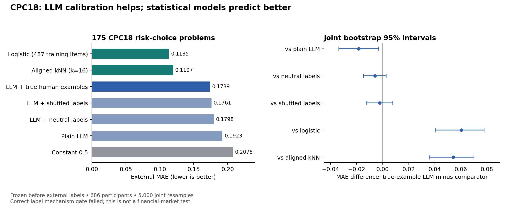

# CPC18 external probability results

The selected human-example LLM forecast improves on plain LLM forecasts in a
different data source, but both frozen statistical models predict human rates
substantially better. The correct-label mechanism gate fails again. These findings
support limited cross-source predictive improvement, not an established mechanism,
financial transfer, persistent investor behavior, or market realism.



The [standalone PDF](figures/cpc18_external_20260922.pdf) can be reproduced with
`.venv/bin/python scripts/plot_cpc18_external.py` from the completed summary.

## Frozen design and execution

Protocol, implementation, 175 eligible GameIDs, demonstration identities, fitted
487-item statistical checkpoint and all statistical predictions were committed in
`0d41d6c` before real calls. P_true with alpha=1 is the unchanged development
selection. Four methods and two target orders produced 1,400 main forecasts;
the separate 16-call smoke also passed. All responses and all 175 pairs per method
were valid. No items were dropped. One main response needed the predeclared format
repair. Successful main calls, including that repair: 1,401; zero cache hits;
769,596 input tokens and 40,664 output tokens. No verified monetary cost is given.

Main forecasts completed at `2026-09-22T09:32:33.379950+00:00`. The label-opening
record was written later, at `2026-09-22T09:32:49.632822+00:00`, from the same
clean frozen commit. Only eligible no-feedback trials 1–5 entered scoring:
84,860 decisions from 686 participants, grouped into 24 Set×Location×Condition
resampling strata. Each person/game contributes five repeated choices.

Plan SHA256: `00566e35cc68cc4a22afa268a70a894d543ed1a6e7ed699048333a3f93902804`.
Source hash: `580af0749e20d70e231ba7195b243ddbef69b17e1516fd75d20cd54622752810`.
Response SHA256: `714ee4388aa13b0c4ddc852f672c511937a06b8e63c1229ffd6d8c973316b98d`.

## Prespecified probability metrics

| Method | MAE ↓ | RMSE ↓ | Mean JS, bits ↓ | Pearson ↑ | Expected ten-action MAE ↓ |
|---|---:|---:|---:|---:|---:|
| Plain LLM P0 | .192307 | .243361 | .050240 | .3328 | .228025 |
| Selected P_true | .173899 | .215053 | .040314 | .5121 | .211269 |
| P_neutral | .179818 | .224090 | .043616 | .4401 | .217336 |
| P_shuffled | .176063 | .219589 | .041814 | .4788 | .214005 |
| Symmetric fractional logistic | **.113514** | **.145888** | **.020400** | .8275 | **.165389** |
| Aligned kNN, k=16 | .119651 | .150345 | .021555 | **.8368** | .170215 |
| Constant .5 | .207766 | .246737 | .052825 | undefined | .240709 |
| Pool mean | .207733 | .246727 | .052822 | undefined | .240694 |
| Pool median | .208106 | .246859 | .052868 | undefined | .240871 |

The analytic ten-action error incorporates independent Bernoulli sampling; it
does not represent persistent people. JS uses the corrected per-item definition,
not the summed value in the original frozen development evaluator. Independent
reconstruction from response records reproduced MAE, RMSE and JS to 1e-12.

## Fixed MAE contrasts

Negative values favor the left-hand method. Primary intervals use the predeclared
joint participant-cluster and problem bootstrap, 5,000 draws, seed 20260925.
The full output also preserves problem-only and participant-only intervals;
interval definitions were not selected after observing results.

| Contrast | Delta MAE | Primary 95% interval |
|---|---:|---:|
| P_true − P0 | −.018407 | [−.033610, −.003089] |
| P_true − P_neutral | −.005918 | [−.014812, +.002745] |
| P_true − P_shuffled | −.002163 | [−.012217, +.007700] |
| P_true − constant .5 | −.033866 | [−.051665, −.014778] |
| P_true − logistic | +.060385 | [+.040580, +.077892] |
| P_true − aligned kNN | +.054248 | [+.035685, +.069920] |
| Logistic − constant .5 | −.094252 | [−.109406, −.076469] |

P_true reduces MAE by approximately 9.6% relative to P0. Nevertheless, neither
label-control contrast excludes zero under the primary uncertainty definition.
Failure of this mechanism gate is not proof that labels have no effect or that
the methods are equivalent. Do not replace the frozen candidate with a newly
selected method or tune a mixture on CPC18. The development mixture had already
selected zero LLM weight; no external mixture was fitted.

## Remaining behavioral differences

Across the 162 non-tied EV comparisons, humans choose the higher-EV option at
.683630 versus P_true .533488, logistic .602150 and aligned kNN .584013. Across
175 variance comparisons, riskier-option preference is human .466374, P_true
.422000, logistic .489530 and kNN .473631. Better total error does not eliminate
these conditional gaps.

P_true's mean absolute order effect is .117714; its signed effect is −.090286
in original-B coordinates. This corresponds to mean first-displayed-option mass
.454857 across the two orders. Symmetric statistical policies avoid that ordering
artifact by construction; their predictive advantage still requires the measured
external evidence above.

## Consequences for the research sequence

1. Preserve the cross-source LLM gain and the stronger statistical result together.
   The project cannot claim that LLMs are necessary for this numeric choice task.
2. Stop expanding lottery prompt variants on this now-opened external set. Proceed
   to financial states, with train-only calibration and both statistical and LLM
   controls. Keep financial test sessions closed until the candidate is frozen.
3. Separate forecasts on recorded human states from a coherent joint portfolio
   policy and from autonomous persistent rollout. Each requires its own validation.
4. Use a matched human market institution and independent market-level targets for
   the main micro-to-macro test. More trades or volatility alone is not realism.
5. Jev comparisons still require real access. Its probability interface is prepared;
   mock contract tests and these LLM findings do not establish Jev performance.

The source is the [official CPC18 release](https://cpc-18.com/data/) and
[raw archive](https://zenodo.org/records/2571510). Visible duplicates against the
complete Choices13k source were excluded before calls. This is validation within
a related task family, with public-data pretraining contamination still possible.
Joint intervals do not identify arbitrary participant populations or task families.

## Artifacts and reproduction

`outputs/human_benchmark/cpc18_external/aigc_relay/test/` contains responses,
transport logs, completion, label opening, and `evaluation/{summary.json,predictions.csv}`.
Both real execution and evaluation exited successfully; no run requires restart.
Full suite: 99 passed; new-file Ruff passed; synthetic-only mock path passed.

From a clean worktree with unchanged frozen inputs:

```bash
.venv/bin/python scripts/run_cpc18_external.py --provider aigc_relay --stage evaluate
```

This reuses frozen forecasts and the same already-opened label scope. It does not
make new model calls. Historical experiments and their frozen source are preserved.
