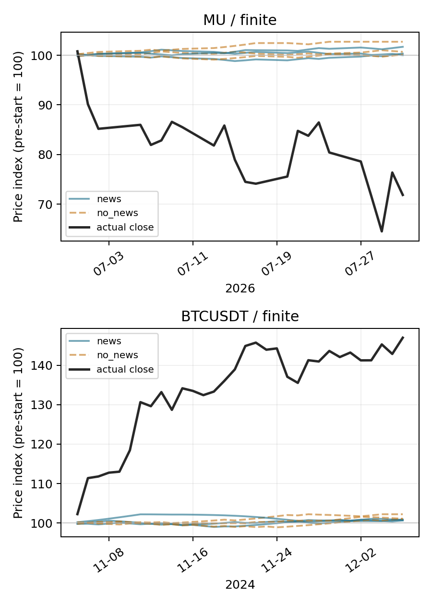

# FYP 研究记录 · 从原始提案到中期实验

整理于 2026 年 11 月 20 日，实验结果截至 11 月 15 日。项目最初的问题是：**如果 AI 投资者在相同处境下更接近真人，由这些投资者自己买卖形成的市场，会不会也更接近现实？** 我们已经观察到个人历史有助于统计模型预测真人买卖，也观察到 AI 换策略会改变模拟市场的成交。要把这两项观察连成结论，还需要先在独立真人资料上确认同一个 AI 方法确实改善了行为，再把它放进同条件的市场比较。[中期汇报稿](fyp_midterm_report_20261115.txt) · [随仓库发布的数据](../research_data/README.md)

## 一、最初的研究提案

提案第 6—12 页把研究对象定为持有现金和一种风险资产的投资者。每个人可以继续原策略，也可以在两种做法之间切换。一种根据价格与估计价值的差距交易，另一种根据近期价格走势交易。程序保存每个人的资产、盈亏、历史和策略，也记录如果此前按另一种规则交易，结果会怎样。买卖双方在模拟交易所报单，有相容的价格和数量才成交。这样，下一次决策看到的钱、股票和价格，可以来自上一次交易。[系统设计](TDD.md) · [实验协议](experiment_protocol.md)

| 原提案 | 原来打算怎样检验 | 到中期已有的证据和缺口 |
|---|---|---|
| 个人行为 | 32 个投资者用 253 个历史交易日做决定。观察遇到亏损、他人选择、策略相对表现和价格偏离时，多少人保留或切换策略 | 已有风险选择、真人下单方向、模型在假设情境中换策略的对照。现有已核实的真人记录能告诉我们买或卖，其对应的两种投资策略仍未知。原定整套行为实验尚待验证 |
| 个人行为如何影响市场 | 20—50 个投资者、30 期，由订单形成价格。比较规则、普通 AI、给定人设的 AI 和根据真人记录调整过的 AI | 20 户、30 天的固定策略与模型选策略对照已完成。完整四类人群在相同制度下与真实市场的比较尚缺 |
| 人群如何放大或减弱冲击 | 同一条坏消息分别给低跟风、高跟风和经真人资料调整过的群体。记录跌幅、成交难度和恢复时间。更广的设计包括无冲击和正向冲击 | 早期做过低、高跟风和冲击试跑，后来也单独改变过模型看到的群体比例。三类群体在同一冲击下的正式比较仍待完成 |

原提案还要求分别去掉个人策略收益比较、群体信息或行为调整，观察哪个环节改变结果。扩大到 20、50、100 个账户和 10—20 个随机起点属于原计划的稳健性检查。行情、财报和宏观资料是原定输入，付费盘口是可选扩展。到中期，研究优先投入了两项工作：找到有真人答案的动作，找到能核对成交价格的历史盘口。[提案对照记录](rp_progress_update_20261022.md) · [已核实的行为任务](../config/research/behavior_target_support_v1.json)

## 二、9 月上半月 · 市场能运行，为什么价格几乎不动？

**第一轮用 Meta 算力消息测试。** 项目归档了 11 只标的的 814 条日线，逐条核对消息何时可见。7 月 1 日美东时间发布的报道到 7 月 2 日开盘才首次进入决策。以 NVDA 为主要观察对象，学校接口完成 12 组历史价格回放和 36 组代理自行报价的市场实验，每次 30 个账户、23 个交易日。历史回放的价格由输入固定，因此研究对象是投资者究竟怎样下单和持仓。换成由订单决定价格时，模型组在不同冲击下的末价都约为 205.19。查看订单才发现，两边数量严重失衡，规则组的成交比模型组多得多。早期另一接口因余额问题停在 24/48 次，单独存档。[首轮实验与失败批次](meta_compute_2026_status.md) · [48 次运行的逐次数据](../research_data/meta_48_runs/run_metrics.csv)

**第二轮尝试让投资者看到盘口。** 我们用 MU 和 SNDK 分别做低、高跟风试验，每天把账户分批放入市场，后到的人可以看到前面留下的报价。低跟风组分别成交了 31 和 30 笔。两个高跟风组却各有 658 个有效买单、零个卖单，整段没有成交。模型愿意接受对方报价，但没有卖家时，报价再积极也买不到。由此我们把“愿意跟随多数”“有人下单”“出现对手方”“形成新价格”分开统计。这个设计每个条件只用了一个随机起点。[四次流动性试跑](memory_market_v2_pilot_results.md)

## 三、9 月中下旬 · “像人一样做决定”能靠提示词实现吗？

为了知道模型错在哪里，我们先找有明确真人参照的问题。Choices13k 记录一群人在两个有风险的方案间如何选择。比较的是模型选择比例与人群比例相差多少。这里的一道题对应一个人群比例，同一个模型回答十次所产生的波动需要单独检查。[数据与试验设计](choices13k_pilot_protocol.md)

| 尝试 | 观察到什么 | 它怎样改变了后续实验 |
|---|---|---|
| 给模型设置人设 | 先用 200 题挑提示，在另 100 题上，平均误差从 0.2851 降至 0.2702，区间仍包含零。随后在 1,000 道新选的无反馈题上，人设组误差 0.2956，高于普通组 0.2779 | 保留前后两组结果，并记录人设在新题上让误差增加。转向尝试从真人例子学习。[小试](choices13k_pilot_results.md) · [扩大后的检验](choices13k_confirmatory_results.md) |
| 提供其他题的真人选择作例子 | 在 400 道测试题上，平均误差约从 0.2837 降至 0.2446。但在另一套 CPC18 的 175 题上，正确例子约 0.1739，打乱答案约 0.1761，两者差别仍不确定；统计方法约 0.1135 | 加入“例子相同、只打乱答案”的对照，检验改善究竟有多少来自真人答案本身。[400 题](choices13k_data_driven_results.md) · [外部 175 题](cpc18_external_results_20260922.md) |
| 改问概率，并换一个模型比较 | 在 200 道已经研究过的开发题上，使用同条件真人例子时，DeepSeek 的误差约 0.1630，Jev 约 0.2082 | 保留相同题目、可见信息和两种选项顺序，明确这批结果只属于开发题及风险选择。[概率实验](probability_calibration_results_20260922.md) · [Jev 对照](jev_development_results_20260923.md) |

## 四、9 月下旬至 10 月初 · 从风险题走到真人金融记录

风险题没有股票余额、挂单或连续交易。我们转向两类有时间顺序的真人资料。Scopic 可以观察一个人已经持有某只股票时是否卖出。核查原表发现，一个看似可以当作“当前财富”的字段使用了下一期价格估值，直接喂给模型就会泄露未来。团队据交易时点重新构造输入，在两场开发实验中，一个看似合理的统计模型只在其中一场胜过固定概率。[账户与时间核查](financial_training_audit_20260922.md) · [Scopic 开发结果](scopic_baseline_results_20260922.md)

另一份实验市场复现资料包含订单、成交和账户记录。我们把整场实验分成 51 场训练、16 场开发和 16 场最终检验。能公平比较的问题收窄为“这个人已经决定下单，接下来是买还是卖？”没有下单的时刻缺少完整记录，用这张表估算观望比例会用错分母。[原始资料与划分](market_replication_data_protocol.md)

16 场开发实验每场取 25 个时点，共 400 个。四套提示各交换一次买卖选项顺序，共收到 3,200 份概率回答。不给示例、给真人示例、打乱示例标签的概率误差分别为 **0.2252、0.2262、0.2262**。利用个人历史的统计模型为 **0.2126**，误差越低越好。此处“不给示例”仍保留当事人的历史输入。真人例子在部分风险题上的优势没有延续到这项交易任务。最后 16 场继续留给方法固定后的检验。[四种提示及统计参照](two_event_final_report_20261004.md) · [机器可读结果](../research_data/behavior/financial_development.json)

## 五、10 月 · 两个新闻事件让我们重新审视成交规则

我们选了 2026 年 Meta 云业务消息下的 MU，以及 2024 年美国大选前后的比特币，分别比较有新闻和无新闻的模拟。首轮 MU 有 14 个买单却没有成交。其中 11 个把对手报价四舍五入成 1147.57，略低于程序里的 1147.570589。对模型来说像是愿意按卖价买，交易程序却判定买价不够。修正价格单位、报价精度和账户信息展示后，短窗口各设置合计，MU 的成交由 0 变成 62 笔，BTC 由 21 变成 82 笔。几项修正一起上线，无法分配各自的作用。[双事件结果与修正记录](two_event_final_report_20261004.md)

| 完整观察窗口 | 真实区间收益 | 三个随机起点的含新闻模拟平均收益 |
|---|---:|---:|
| MU，2026-06-29 至 07-31 | −28.14% | +0.68% |
| BTC，2024-11-04 至 12-06 | +47.00% | +0.75% |

这两个回报是区间观察，期间还有其他事件。大部分模拟成交仍涉及程序设置的做市商。这个结果促使我们采用导师提出的盘口检验：如果只知道一天的收盘价，就无法知道当时想买十股的人能以什么价格买到多少。我们取得了 Bybit 比特币永续合约的交易所档案，可以按价位核对挂单数量。数据来自中心化交易所，原提案所需的执行检验在这里可以取得直接参照，链上交易属于另一个数据来源。[双事件数据](../research_data/two_events/summary.json) · [盘口研究设计](crypto_execution_validation_design_20261011.md)

11 月 1—7 日的 14 份档案属于 **2024 年的行情样本**。最初的检查程序把每日档案跨过午夜约两秒的部分误报为日期错误，修正后按数据在当时何时可见重建盘口。拿前三天的 4,371,215 笔真实成交，给定每笔的方向和数量，与“只看最优价”比较。零附加延迟时，扫过多个价位在共同样本上平均少错约 0.0057 个基点，在需要跨价位的子集中少错约 0.1581 个基点。一个基点是 0.01%。这说明盘口深度在哪些单子上值得使用。真实成交的方向与数量在这里已经给定，自主生成订单仍需单独实验。[档案核查](active_research_status.md) · [成交价格结果](crypto_execution_full_train_results_20261015.md)

随后试着预测每秒有多少笔成交。把“这一秒有无成交”和“有成交时有几笔”分开建模，比单纯增加盘口字段带来的改善更大。另用完全人为设定的环境跑完两种方法、两种处理顺序、三种延迟和 20 个随机起点，共 240 条轨迹。在六组同条件比较里，新增方法均未降低预设综合误差。扩大批量实验的预检只完成了部分计划，不能把排好的运行表当作实际结果。[七日计数检验](crypto_activity_aux_results_20261013.md) · [六组比较和 240 条轨迹](../research_data/market_synthetic_240)

## 六、10 月下旬 · 看似相同的回答与看似合理的解释

**重复回答改变了对样本量的理解。** 回查早期 200 道风险题的 2,000 份回答，196 道出现回答编号、时间和正文一起重复。普通提示与人群的平均差距是 28.33 个百分点，始终猜一半的差距为 18.17 个百分点。记录保留了每次收到的回答，同时把“收到几次”和“能确认多少次独立生成”分开。在另一个固定问题中，真人有 65% 选 B。无参考、正确参考和打乱参考三组分别有 7/8、5/8、3/8 选 B。正确参考平均最接近真人，但换四种显示方式后，其比例从 0% 到 100% 都出现过，每格只有两份回答。后来所有关键比较都保留两种排列下的原值。[重复回答核查](choices13k_p0_full_calibration_reuse_20261022.md) · [单题的 24 份回答](choices13k_tradeoff_execution_20261022.md)

**让模型解释换策略，也暴露了读数错误。** 从旧记录重建 720 次复盘机会，其中 540 次为模型回答。普通、低跟风和高跟风提示的换策略率分别为 24.4%、21.7%、13.3%。亏损集中于某个复盘日期，日期、新闻和亏损同时变化，单看这些比例分不清发生变化的原因。在专门核查的四段理由中，一段声称价格“低于参考价”，而输入的两者都等于 95。后来把读对账户事实、对某条信息作出反应、实际改变订单拆成三个检查。[复盘核查](style_switching_20261022.md) · [价格读数错误](style_rationale_grounding_20261022.md) · [事实检查](style_fact_results_20261022.md)

**把人的历史选择接到一个会花光现金、卖光股票的账户，又出现了另一类偏差。** 在 10 月 23 日的单独分支里，我们复查了 42,780 次状态变化。早版有 634 次因现金或股票不足而拒单，逐一检查时，另一个方向在当地状态都可行。随后固定原有模型和行情，比较直接提交与先按账户能力限制动作两套接口，完成 1,280 条轨迹、85,560 步。接口改动通过了下单可行性的检查。某些行为出现次数仍太少，无法比较哪种方法更能保持真人跨期的习惯。后来的连续买卖试跑把“这个时点能不能问”和“问到后选哪个方向”分别保存。[受限账户实验的判定和各组数据](../research_data/behavior/restricted_action_interface.json)

## 七、11 月上旬 · 模型说要换策略，账户接下来会怎样？

**先把收益算对。** 初版比较把正信号理解成全仓、没有信号理解成清仓。实际交易规则在没有信号时继续持有股票。同一个标成“替代策略赚 10%”的情境，按账户和规则重算，在无价差时变为 0%，买卖各让价 0.05 时变为 −0.0208%。随后程序分别为当前规则、替代规则和实际账户记账，换策略时从当时的现金和持仓开始下一段。把收益口径修正后，两份假设账户在替代策略过去较好时各有 3/3 次改选，在较差时各为 0/3。另做 36 次群体信息对照，四个情境中两个随多数方向变化、一个反向、一个不变。[经济对照数据](../research_data/strategy/economic.json) · [群体对照数据](../research_data/strategy/population.json) · [复算经过](research_progress_20261106.txt)

**再让策略进入市场。** 最初的纯规则试验用了 20 个账户、10 天、三个随机起点，更新规则都没有触发换策略，两组交易相同。后来的 20 户、30 天试验改为模型每五天选一次策略，日常仍按规则下单。共 120 次模型询问。固定策略组成交 54 笔、129 股、末价 104.59。模型定期选策略组成交 64 笔、161 股、末价 104.90。最后一天的复盘发生在交易结束后，只能影响尚未观察的下一期。两组末价差 0.31 乘以 40 股，恰好解释了 12.4 的总账面财富差。这个构造市场证明了选择能传到交易，价格是否更接近现实仍需外部参照。[两组逐日行情、订单和成交](../research_data/market_20x30)

**改变起始持仓也会改变成交。** 在三个随机起点，把每户初始资产从 1,000 现金加 2 股，改为 600 现金加 6 股，按初价 100 计算财富相同。新组的原始成交股数三次都更多；改用成交量除以初始流通股数后却是一升两降。比较市场时要事先确定量纲，以及是否同时改变了现金和流通股数。[起始资产六次运行](../research_data/market_20x30/endowment_comparison.json)

## 八、11 月上中旬 · “历史有用”究竟在哪一步成立？

1. **先看真人记录里有无信号。** 在 51 场旧训练实验的 63,143 个已下单时点上，每次用一部分场次学习，预测另一组场次。依次提供账户与公开信息、再加本期个人历史、再加更早回合历史，同一类统计模型的概率误差从 0.2415 降到 0.2276，再到 0.2158。分解误差后，主要改善来自更好地估计每个人总体偏买还是偏卖。换一种简单算法，把所有历史合成一个买入比例，反而略差于只看本期。这是旧训练资料上的方法探索。[个人历史得分](../research_data/behavior/statistical_memory.json) · [误差拆分](../research_data/behavior/error_breakdown.json)
2. **再看语言模型会不会响应历史。** 给同一个假设账户安排四种过去，改变本期与已完成期的买卖次数，让模型在三种可见范围、两种选项排列下各答两遍。48 份回答中，按事先规定的方法扣除隐藏历史时的差异，本期历史对应 29 个百分点、上一期对应 17.5 个百分点的买入概率差。换排列时差距最大达 40 个百分点，完全相同输入重复提问也可相差 30 个百分点。这是回答对历史的敏感度，真人一致率在这项实验里未知。[假设情境及结果](../research_data/behavior/invented_memory_detail.json)
3. **最后让模型面对自己刚造成的账户状态。** 11 月 15 日用两个虚构账户、连续两期、三档历史范围试跑。每个可下单状态问两种排列，平均买入概率，用事先固定的随机数选方向。共问 24 次。每档都有 12 个潜在机会，接受 4 单，另外 8 次被挂单或可用持仓等条件挡住。三档都是先两买、再两卖，全部零成交。每户现金由 500 变为 540，全来自分红。模型只在每期开始时被问到，因此见到了跨期的挂单记录，却没有在本期已经下过单后再次回答。本地手算例另外验证了先成交 2 股、再成交 1 股的账务。两个例子各自覆盖的状态已经记录。[实际三档结果](../research_data/memory_market/summary.json) · [询问覆盖](../research_data/memory_market/coverage_diagnostic.json) · [本地部分成交例](../research_data/memory_market/partial_fill_local_demo.json)

工程实现也经历过失败。采集器第一版在后台线程与事件循环之间传递回调，模拟接口测试卡住。改成先保存同一时点所有账户能看到的信息、收齐回答、最后统一下单，既解开了卡住的问题，也保证后答的模型看不到同批另一个账户刚下的单。修正中曾漏掉复制函数的导入，后续还补上了负延迟反例。通过保存的回答重新运行后，三个账户分支的订单与余额均能逐项重现。九项中期交付到此验收，最后的零成交保留为实际观察。[执行器](../scripts/collect_conditional_market_pilot.py) · [故障与重放测试](../tests/test_conditional_market_collection.py) · [离线重放方法](../research_data/README.md)

## 九、中期后还缺哪一个决定性实验？

当前证据支持先选一个有真人答案的问题，例如“已决定下单时，是买还是卖”。固定真人与模型看到的信息、比较方法和评分，先用未参与调整的场次检验行为。若不同提示显示方式下仍有改善，再把**同一个经过验证的决策方法**放进交易制度、初始资产、冲击和随机起点相同的市场。届时应一起比较价格偏离、成交、跌幅和恢复时间。要保留提案原定的“是否从基本面切到技术策略”为主要真人指标，还需要找到可以直接核实这项选择的真人记录。最终 16 场检验与三类群体压力比较均是后续工作。[中期报告与答辩提纲](fyp_midterm_report_20261115.txt)

### 11 月 20 日的代码核对

从待发布的干净目录用已保存的 24 份回答重建三条市场路径，并与发布的 JSON 逐字段核对。连续下单、示例执行和小型市场的 38 项测试通过。另在原工作区运行了完整测试集，2,020 项通过、76 项失败、109 项在测试准备阶段出错。错误涉及历史采集器要求旧版本源码、部分旧测试缺少名为 context 的测试环境，以及返回格式和样例账户字段与当前实现不一致。旧实验数据按当时的记录引用，复核入口和结果适用范围见数据说明。[离线重放与数据校验](../research_data/README.md)
