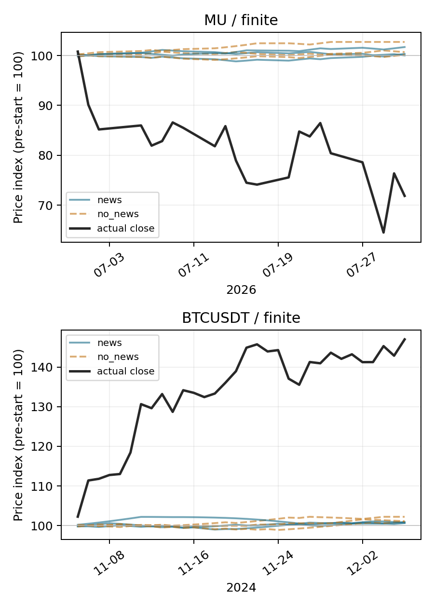

# 双事件扩展：全部种子与流动性结果

每格6名代理，3组种子。私人配置目标仍是合成偏好，尚非真人标定。表中的新闻增量是有新闻减无新闻，不能把全部模拟涨跌当作新闻效应。区间仅是3个模拟种子的重采样描述，不能解释为现实市场的因果置信区间。

| 资产 | 流动性 | 有新闻平均收益 | 无新闻平均收益 | 平均新闻增量百分点 | 种子最小/最大 | 种子重采样95%区间 |
|---|---|---:|---:|---:|---|---|
| MU | finite | +0.676% | +1.181% | -0.505 | [-1.022, +0.181] | [-1.022, +0.181] |
| BTCUSDT | finite | +0.748% | +1.435% | -0.687 | [-1.588, -0.114] | [-1.588, -0.114] |

同期实际收益（严格使用各模拟开始前一天收盘为基准）：
- MU：2026-06-29至2026-07-31，-28.137%。
- BTCUSDT：2024-11-04至2024-12-06，+47.002%。

每个种子的原始对照：

| 资产 | 流动性 | 种子 | 有新闻收益 | 无新闻收益 | 有新闻成交 | 无新闻成交 | 新闻组做市成交占比 |
|---|---|---:|---:|---:|---:|---:|---:|
| MU | finite | 7 | +0.010% | +0.683% | 69 | 63 | 91.3% |
| MU | finite | 42 | +0.327% | +0.147% | 96 | 64 | 88.5% |
| MU | finite | 2026 | +1.692% | +2.715% | 75 | 54 | 92.0% |
| BTCUSDT | finite | 7 | +0.625% | +2.213% | 60 | 67 | 88.3% |
| BTCUSDT | finite | 42 | +0.895% | +1.008% | 66 | 100 | 90.9% |
| BTCUSDT | finite | 2026 | +0.725% | +1.084% | 78 | 49 | 93.6% |

全部12格、2088条决策完成并与原始JSON逐笔核对；72对消息前观察及决策相同。拒单63笔；现金和份额守恒。
成功新调用token用量：{'completion_tokens': 126877, 'prompt_tokens': 3217245, 'total_tokens': 3344122}；响应状态：{'200': 2016, 'ok': 72}；缓存72条。

日期和资产名称仍然可见，尤其2024大选可能属于模型已有知识；无新闻组不等于完全未知历史。没有未来实际价格输入内生市场，但这不能消除模型自身的历史记忆。实际日线覆盖全天，模拟只在固定轮次决策。

